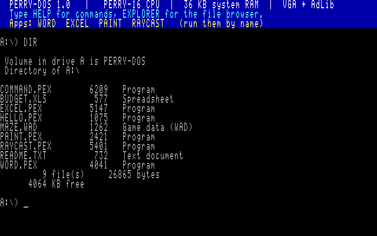
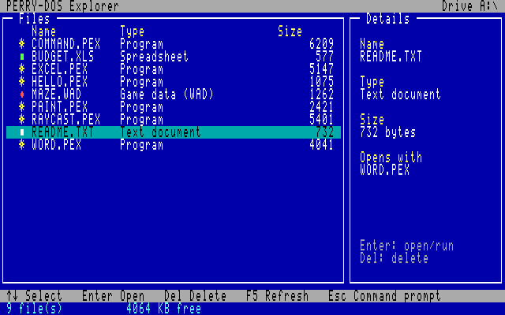
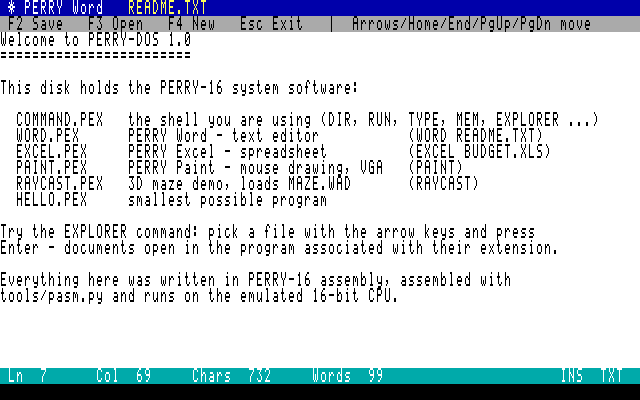
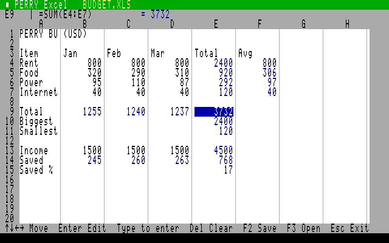
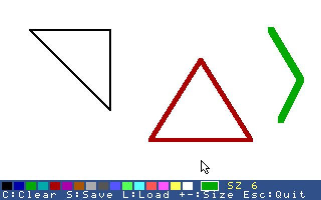
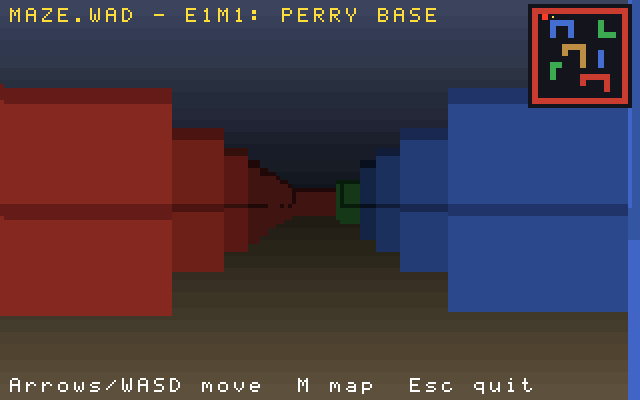

# PERRY-16

A complete custom 16-bit computer built from scratch: CPU (C++ emulator
**and** synthesizable SystemVerilog), assembler, executable format, a
DOS-style operating system with a file explorer, productivity apps and a
Wolfenstein-style 3D game – all running on the same custom ISA.

| | |
|---|---|
|  |  |
|  |  |
|  |  |

## What's inside

| Component | Where | Notes |
|---|---|---|
| CPU emulator | `emu/cpu.cpp` | 8 × 16-bit registers, flat 64 KB, 2/4-byte instructions, ~55 MIPS on a modern host |
| CPU in hardware | `rtl/perry16_cpu.sv` | multi-cycle SystemVerilog core, verified in lockstep against the emulator |
| Machine + firmware | `emu/machine.cpp`, `emu/bios.cpp` | VGA text/13h with banked VRAM and DAC, keyboard, mouse, AdLib OPL2 (`emu/opl2.cpp`), INT 10h/16h/21h/33h |
| Disk | `emu/pfs.cpp`, `tools/mkdisk.py` | `disk.img` with the PFS file system; saves persist |
| Assembler | `tools/pasm.py` | two-pass, labels/locals/sections/expressions/includes → `.PEX` or `.bin` |
| Executable format | `emu/pex.h` | `PEX\0` header: load address, entry, code/data/bss/stack sizes, checksum |
| PERRY-DOS | `os/command.asm` | `DIR RUN TYPE DEL CLS MEM VER DATE TIME HELP EXIT`, file associations, full-screen **EXPLORER** |
| Apps | `apps/word.asm`, `apps/excel.asm`, `apps/paint.asm` | text editor, spreadsheet with formulas, mouse paint program |
| Game | `games/raycast.asm`, `tools/mkwad.py` | WAD loading via INT 21h, PLAYPAL → DAC, DDA raycaster, 2× blit, OPL2 music |
| Frontends | `emu/main.cpp` | SDL2 window + sound, ANSI terminal, headless scripting, bare-metal mode |
| Tests | `tests/` | assembler, CPU self-test, RTL lockstep + random fuzzing, 6 end-to-end OS/app scenarios |

## Quick start

```sh
sudo apt install g++ python3 libsdl2-dev iverilog   # SDL2 / iverilog optional
make            # builds build/perry16, all .PEX programs and build/disk.img
make run        # boot PERRY-DOS in a window (terminal fallback without SDL2)
make term       # or in the terminal (Ctrl+Q quits)
make test       # full test-suite
```

At the `A:\>` prompt try `DIR`, `MEM`, `EXPLORER`, `WORD README.TXT`,
`EXCEL BUDGET.XLS`, `PAINT`, `RAYCAST`.

Write your own program:

```asm
        ORG 0x3000
        ENTRY main
        %include "perry.inc"
SECTION .code
main:   MOV DX, msg
        MOV AX, DOS_PUTS << 8          ; INT 21h AH=09h: print ASCIIZ
        INT INT_DOS
        MOV AX, DOS_EXIT << 8          ; INT 21h AH=4Ch: back to the shell
        INT INT_DOS
SECTION .data
msg:    DB "Hello, PERRY-16!", 13, 10, 0
```

```sh
python3 tools/pasm.py hello.asm -o build/MYHELLO.PEX
python3 tools/mkdisk.py build/disk.img build/*.PEX build/MAZE.WAD disk/*
build/perry16 build/disk.img        # then type MYHELLO
```

## Memory map

| Range | Use |
|---|---|
| `0000-03FF` | interrupt vector table (256 × 4 bytes) |
| `0400-0FFF` | BIOS data area, command line, DTA, free |
| `1000-9FFF` | system RAM: shell at `1000`, programs (TPA) at `3000` |
| `A000-B7FF` | graphics window into the 64 000-byte 320×200×256 framebuffer (4 KB banks, port `3CDh`) |
| `B800-C79F` | text VRAM 80×25 (char, attribute) |
| `C800-EFFF` | upper RAM |
| `F000-FFFF` | ROM: interrupt stubs, BIOS id, 8×8 font |

Why the VRAM ranges differ slightly from a naive layout (64 000 bytes
don't fit in 6 KB, 4 000 bytes don't fit in 1 KB) is explained in
[docs/ARCHITECTURE.md](docs/ARCHITECTURE.md#why-two-ranges-differ-from-the-original-sketch).

## Documentation

* [Architecture guide](docs/ARCHITECTURE.md) – layers, memory map, devices, firmware model, process model, emulator and RTL internals
* [Instruction set](docs/ISA.md) – registers, flags, encodings, opcode map, timing
* [BIOS & DOS API](docs/BIOS_DOS_API.md) – INT 10h/16h/21h/33h and I/O ports
* [PEX format & loader](docs/PEX_FORMAT.md) – header, loader code, process lifetime, PFS disk format
* [Assembler](docs/ASSEMBLER.md) – syntax, directives, runtime library, calling convention
* [Doom / Wolf3D strategy](docs/DOOM_WOLF3D.md) – what a 16-bit port needs and how RAYCAST implements the pipeline today

## Repository layout

```
emu/      C++ emulator: cpu, machine/devices, bios (HLE services), pfs, opl2, frontends
rtl/      SystemVerilog core + testbench
tools/    pasm.py (assembler), mkdisk.py, mkwad.py, genfont.py, gentables.py, pngopt.py
include/  perry.inc + runtime library (stdio, tui)
os/       COMMAND.PEX - shell and explorer
apps/     WORD, EXCEL, PAINT, HELLO
games/    RAYCAST + generated trig tables
disk/     files copied onto disk.img (README.TXT, BUDGET.XLS)
tests/    run_tests.py, CPU self-test, fuzzer, scenario scripts
docs/     guides and screenshots
```
